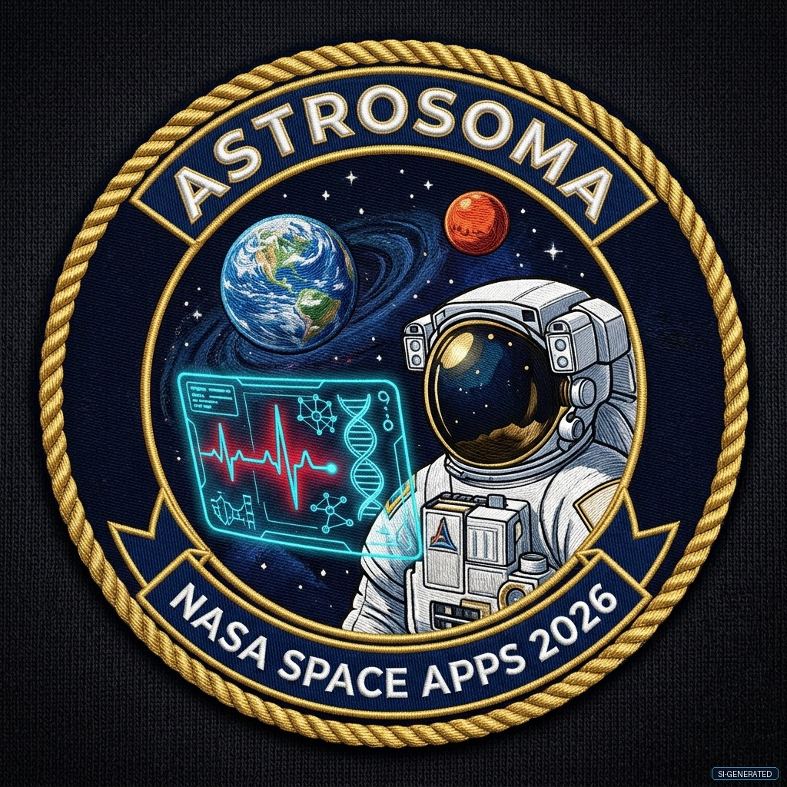

<div align="center">
  
  <h1>AstroSoma</h1>
  <p><strong>Zero-SRAM Bioneural &amp; Homeostatic Health Monitoring Software for Astronauts on Space Missions</strong></p>
  <p>
    <a href="https://astrosoma.space/">Live Console (https://astrosoma.space/)</a> ·
    <a href="docs/AstroSoma_Presentation_EN.pdf">Presentation PDF (EN)</a> ·
    <a href="docs/AstroSoma_Presentation_TR.pdf">Sunum PDF (TR)</a> ·
    <a href="docs/ARCHITECTURE.md">Architecture</a>
  </p>
</div>

---

## Challenge & Mission Overview

Built for the **NASA Space Apps Challenge 2026** (*Create Health Monitoring Software for Astronauts on Space Missions*), **AstroSoma** provides a standalone, offline-first medical & wellness dashboard engineered for **non-medical flight crews** operating across **Crew Spacecraft (Orion)**, **Orbital Space Stations (ISS)**, **Pressurized Surface Rovers**, **Artemis Lunar Habitat Bases**, and **Mars Transit Habitats** (up to 22-minute one-way signal blackout).

### Key Capabilities

- **Dual-Layer Safe Triage:** Combines deterministic **NASA-STD-3001 / AHA / ALARA clinical guardrails** across **7 clickable human anatomy regions** (`neuro`, `ocular`, `cardio`, `resp`, `metab`, `musculo`, `immune_rad`) with the zero-SRAM `WERR-24` homeostatic stability engine (`0 bytes` of mutable neural weight SRAM).
- **24-Byte (`192-bit`) `WERR-24` Telemetry & SEU Resilience:** Packs 12 physiological/cabin indicators + environment ID into `24 bytes` protected by `CRC-16/CCITT-FALSE`, detecting `192/192` single-bit cosmic-ray upsets without weight corruption.
- **CEIT `LearningGate` Crew UX & Gamification:** Translates telemetry into clear plain-language explanations, Zone of Proximal Development (ZPD) Tier 1/2/3 adaptive guidance, daily `290 XP` adherence missions, badges, and interactive micro-quizzes for non-medical crew members.
- **Sensor & Live Space-Weather Integration:** Includes experimental webcam optical rPPG pulse estimation, JSON/CSV sensor import, Lead-II ECG & 14-Sol trend plotting, live **NOAA SWPC** solar proton (`>=10 MeV`) & `Kp` tracking, and **NASA OSDR** study linking via Cloudflare Pages Edge (`/api/nasa-osdr`), backed by a verified offline JSON cache (`data/verified_nasa_telemetry.json`).
- **Bilingual Interface (`EN` / `TR`)**: Instant full-console language switch and synchronized 7-slide HTML & PDF presentations (`demo/slides_en.html`, `demo/slides_tr.html`).

---

## Repository Structure

```text
astrosoma/
├── index.html                          # Interactive bilingual web console (EN / TR)
├── assets/
│   ├── astrosoma_mission_patch.jpg     # Watermarked mission patch (SI-GENERATED)
│   ├── css/styles.css                  # Aerospace dark-mode responsive stylesheet
│   └── js/
│       ├── werr24_core.js              # Bit-exact JS engine matching Python codec & triage
│       └── app.js                      # 7-region SVG anatomy, ECG/trends, rPPG & quizzes
├── functions/api/nasa-osdr.js          # Cloudflare Pages Function CORS proxy for NASA OSDR
├── data/
│   ├── verified_nasa_telemetry.json    # Cached live NASA OSDR studies & NOAA SWPC feeds
│   └── hrp_hazards_catalog.json        # Structured mapping to 5 NASA HRP Hazards
├── src/astrosoma/
│   ├── codec_werr24.py                 # 24-byte WERR-24 binary codec & CRC-16 SEU test
│   ├── clinical_triage.py              # 5 environments, 7 anatomy regions, clinical limits
│   ├── pedagogy_engine.py              # CEIT LearningGate ZPD engine, quests & quizzes
│   ├── nasa_data_client.py             # TLS-verified NASA OSDR & NOAA SWPC sync client
│   ├── cli.py                          # CLI evaluator (--scenario, --simulate-seu, --sync-nasa)
│   └── build_presentations.py          # Renders 7-slide EN/TR HTML decks & PDF exports
├── tests/test_astrosoma_core.py        # Pytest suite + Python<->Node.js bit-exact parity
├── demo/                               # Standalone EN & TR interactive HTML slide decks
└── docs/                               # ARCHITECTURE.md & EN/TR PDF pitch presentations
```

---

## Quick Start

### 1. Run Automated Verification & Python ↔ JavaScript Parity Tests

Requires Python `3.10+` (`pytest`) and Node.js `18+`:

```bash
python -m pytest -v tests/test_astrosoma_core.py
```

### 2. Run CLI Telemetry, Triage & SEU Simulation

```bash
# Inspect Mars signal-delay blackout or solar storm telemetry with SEU fault injection
PYTHONPATH=src python -m astrosoma.cli --scenario solar_storm --simulate-seu
PYTHONPATH=src python -m astrosoma.cli --scenario mars_blackout --simulate-seu

# Refresh live NASA OSDR & NOAA SWPC datasets into data/verified_nasa_telemetry.json
PYTHONPATH=src python -m astrosoma.cli --sync-nasa
```

### 3. Open the Web Console Locally

Serve the repository root with any static HTTP server (required for `fetch('./data/verified_nasa_telemetry.json')`):

```bash
python -m http.server 8080
```

Then visit `http://localhost:8080/` or open the live deployment at **[https://astrosoma.space/](https://astrosoma.space/)**.

---

## Team & Scientific Foundations

| Member | Handle | Role & Affiliation |
| --- | --- | --- |
| **Dağhan Dağlı** | `@Lexovian` | Team Owner — High School Student Researcher, Toros Science High School, MEV (Toros University); AI & Systems Architecture (`Lexovian/WerrSoma`) |
| **Dr. Zerrin Dağlı** | `@jesmaat` | Co-Investigator — Ph.D., Department of Computer Education and Instructional Technology (CEIT), Mersin University (`jesmaat/WerreduR`) |
| **Volkan / `@pCwOrM`** | `@pCwOrM` | Collaborator — Cloud Infrastructure, Full-Stack Integration & Space Apps Ops |

### Foundational Open-Source & Research Works

- **0-SRAM Procedural Homeostasis Engine:** `Lexovian/WerrSoma` — Zenodo DOI: `10.5281/zenodo.22996625`
- **Adaptive LearningGate & Procedural Fractal Pedagogy:** `jesmaat/WerreduR` — SSRN: `7641538` · Zenodo DOI: `10.5281/zenodo.23128224`
- **Official Telemetry & Hazard Sources:** NASA Human Research Program (HRP 5 Hazards), NASA Open Science Data Repository (OSDR), NOAA Space Weather Prediction Center (SWPC), Canadian Space Agency (CSA/ASC).

---

## Contact & Disclaimer

- **Team Email:** `info@astrosoma.space`
- **NASA Space Apps Team:** [spaceappschallenge.org/2026/find-a-team/astrosoma1/](https://www.spaceappschallenge.org/2026/find-a-team/astrosoma1/)
- **Disclaimer:** AstroSoma is a functional software prototype built for the NASA Space Apps Challenge 2026 for simulation, crew education, and telemetry prototyping; it is not a cleared clinical diagnostic device.
- **License:** [Apache-2.0](LICENSE)
